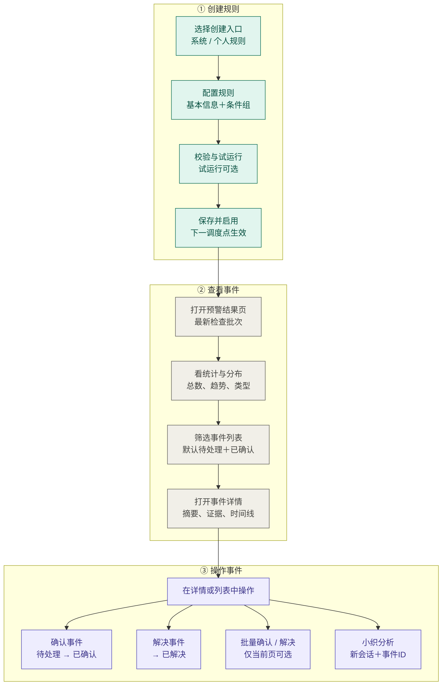
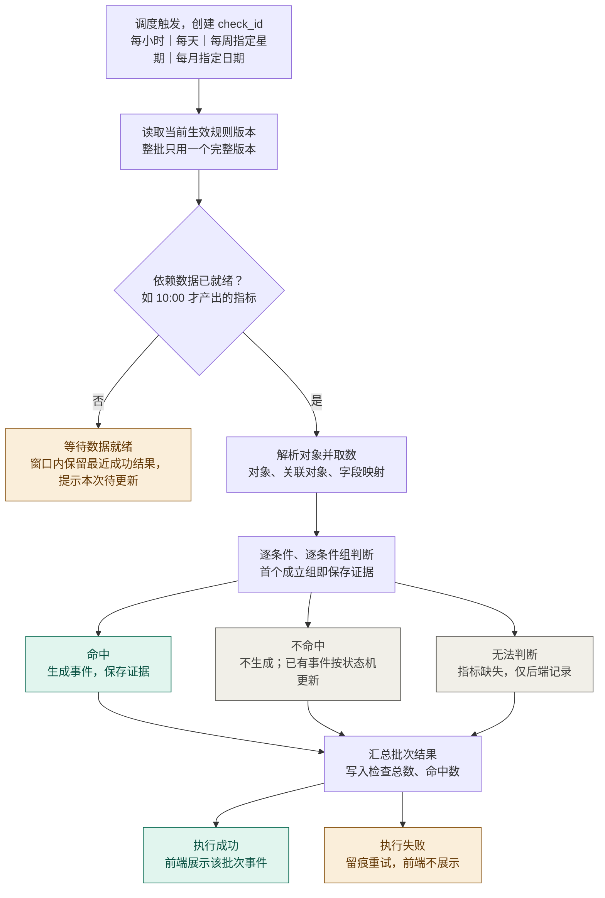
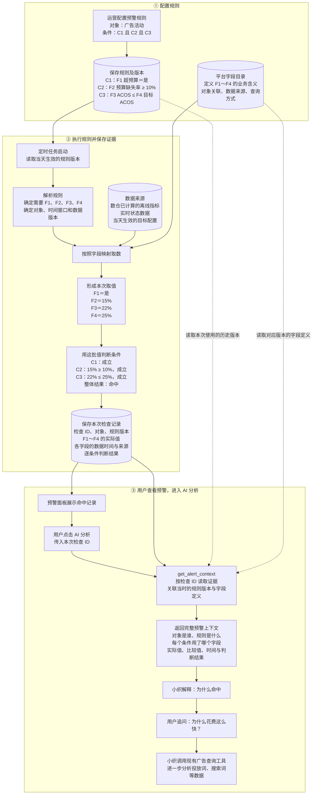
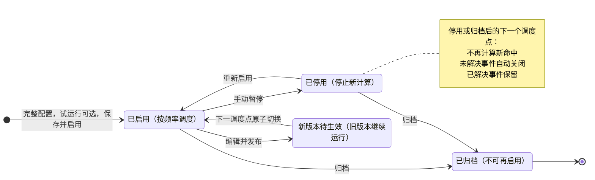
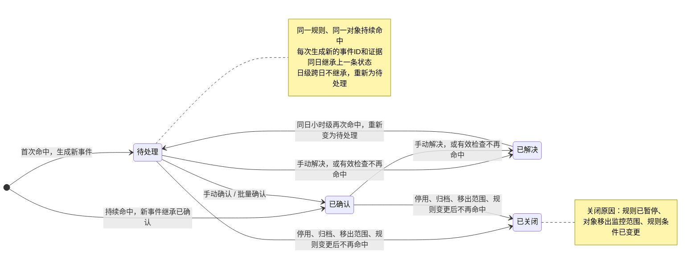
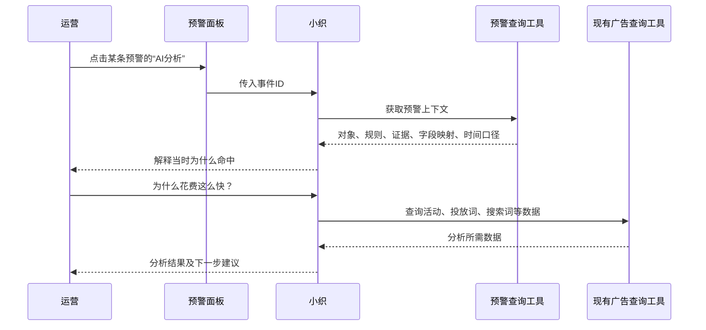

**文档信息**
- 版本：V1.3 规则频率同步稿｜更新日期：<mention-date start="2026-10-09"/>；保留原产品决策，新增四种可配置规则频率及对应事件展示窗口。
- 文档状态：核心产品决策已同步；未覆盖的实现边界单独列于 9.6，不将已确认事项重复列为待决策。
<callout icon="📌" color="yellow_bg">
	**阅读约定**：正文保留原产品决策，并同步本次规则频率调整：每小时、每天、每周、每月可配置；事件按当天／最近7天／最近31天选每条规则最新有效检查。暂停、归档及其他修改统一在该规则当前生效配置的下一个计划调度点生效。“已确认”按本次结论执行；仍标为“建议”或“待补充”的细节不冒充已定稿。用户已有的业务场景、流程图及设计初稿继续保留。
</callout>
<table_of_contents/>
# 一、需求概述与版本范围
## 1.1 需求背景与业务问题
运营需要持续识别商品、库存和广告投放中的异常及机会。不同客户使用的指标、业务目标和权限粒度不同，需要通过可配置规则形成统一预警入口。
预警结果必须能解释“哪个对象、哪条规则、哪几个条件、使用什么时间范围的数据而命中”。规则和业务目标会变化，因此分析需要保留命中当时的规则版本与数据证据。
## 1.2 目标用户与核心使用场景
- 公司高层：公司内确定的需要持续执行的监控标准，基于监控标准，每天发现机会和预警
- 团队管理员：团队内确定的需要持续执行的监控标准
- 运营个人：个人工作需要的补充监控
## 1.3 产品目标
1. 将业务判断表达为可执行的预警条件。
2. 按固定频率检查权限范围内的对象，形成最新预警结果。
3. 通过确认、解决和处理记录支持运营跟进。
4. 小织基于事件证据解释命中原因，并支持查询最新业务数据进一步分析。
<empty-block/>
## 1.4 第一期支持范围与未来的规划
**支持范围**
- 七类预警对象：父 ASIN、子 ASIN、广告活动、推广品子 ASIN、投放词、搜索词（父 ASIN统计维度）、搜索词（子 ASIN统计维度）。
- 系统规则与个人规则配置、分类展示、完整配置后的试运行、启停及归档；系统规则由指定角色共同管理，不依赖原创建人接管。
- 支持每小时、每天、每周、每月规则调度，频率由用户配置；各指标保持独立的数据时间口径，证据与版本在后端留存。
- 最新检查批次的预警结果、统计趋势、详情、手动状态变更和批量确认；不提供导出功能。
- 基于单个事件的个人小织会话与后续分析。
**未来规划**
- 站外通知、站内未读提醒；
- 规则模板（含保存为模板、模板库、从模板创建）、规则复制、面向用户的版本历史与回滚。
## 1.5 业务全流程

# 二、预警对象与指标规则
## 2.1 核心概念
<table header-row="true">
<tr>
<td>概念</td>
<td>定义与关系</td>
</tr>
<tr>
<td>规则</td>
<td>用户维护的配置，包含规则分类（系统 / 个人）、对象、条件、监控范围、预警类型、级别、规则频率及对应星期／日期</td>
</tr>
<tr>
<td>规则版本</td>
<td>某次生效配置。后端保留版本，使历史检查能解释其使用的条件。</td>
</tr>
<tr>
<td>检查记录</td>
<td>检查 ID 标识一次任务调度批次，一个规则一个检查ID；检查ID需要记录本次检查总数，以及命中事件总数</td>
</tr>
<tr>
<td>预警事件</td>
<td>一次检查记录可产生多条事件，每条事件有独立事件 ID；同日小时级重复命中不沿用原事件 ID，一个事件仅关联一个事件证据。</td>
</tr>
<tr>
<td>规则负责人 / 对象负责人</td>
<td>前者维护规则；后者用于确定结果快照的访问范围，两者分别判断。</td>
</tr>
</table>
## 2.2 支持的预警对象与对象识别方式
一条规则只能选择一个预警对象。第一期共七类：父 ASIN、子 ASIN、广告活动、推广品子 ASIN、投放词、搜索词＋父 ASIN、搜索词＋子 ASIN；两种搜索词对象保留为独立选项。
父 ASIN 预警仅对以父 ASIN 维护权限的客户开放。按子 ASIN 维护权限的客户不能选择父 ASIN 预警，也不能引用父 ASIN 指标。
对象定位必须包含租户、店铺、站点及业务对象标识；组合对象需要包含相应 ASIN 和搜索词。不能仅凭可重复的展示名称定位对象。具体主键字段由接口方案定义。
## 2.3 预警对象与统计对象的关联关系
<table header-row="true">
<tr>
<td>预警对象</td>
<td>可引用的统计对象</td>
<td>关联要求</td>
</tr>
<tr>
<td>父 ASIN</td>
<td>父 ASIN</td>
<td>自身对象。</td>
</tr>
<tr>
<td>子 ASIN</td>
<td>子 ASIN、父 ASIN</td>
<td>按所属父子关系关联；仍受父级指标权限限制。</td>
</tr>
<tr>
<td>广告活动</td>
<td>广告活动、子 ASIN、父 ASIN</td>
<td>根据广告活动最大花费子 ASIN /父ASIN关联</td>
</tr>
<tr>
<td>推广品子 ASIN</td>
<td>推广品子 ASIN、广告活动、子 ASIN、父 ASIN</td>
<td>按所属活动、对应子 ASIN 及父子关系关联。</td>
</tr>
<tr>
<td>投放词</td>
<td>投放词、广告活动、子 ASIN、父 ASIN</td>
<td>根据所在广告活动最大花费子 ASIN /父ASIN关联 根据对应的广告活动关联广告活动你好数据 </td>
</tr>
<tr>
<td>搜索词＋子 ASIN</td>
<td>搜索词＋子 ASIN、子 ASIN</td>
<td>按同一子 ASIN 关联。</td>
</tr>
<tr>
<td>搜索词＋父 ASIN</td>
<td>搜索词＋父 ASIN、父 ASIN</td>
<td>按同一父 ASIN 关联。</td>
</tr>
</table>
<empty-block/>
## 2.4 通用指标、定制指标及客户可用范围
指标数据来源【预警字段说明】：[https://app.notion.com/p/3d768e98446680eeab25ea02ae6a05f2?source=copy_link](https://app.notion.com/p/3d768e98446680eeab25ea02ae6a05f2?source=copy_link)
- L2 为通用指标，产品能力可供客户使用；L3 为客户定制指标，仅对应定制客户可用，例如致一、飞阅。
- 指标展示名称采用“统计对象·指标名称”，定制指标增加“定制”角标。
- 指标候选范围同时受预警对象、客户开通情况、关联关系和比较兼容性约束。
- 通用**不等于已经为全部租户准备好数据**。数据按已合作租户准备；实际开放名单见 9.4。
- 各对象的字段、可选枚举、时间窗口及可比较指标，以《预警字段说明》第二章为详细依据。
## 2.5 指标类型、运算符与跨指标比较规则
具体规则可见【预警字段说明】
- 比较支持 ≥、＞、≤、＜、＝、≠、区间；区间开闭、数值精度与系数取值范围见 D08。
- 比较“固定值”时输入数值；比较“另一个指标”时选择兼容指标并输入系数，含义为“字段 A 与字段 B × 系数”比较。
- 枚举：用户通过下拉选择具体对象或候选值；布尔：选择“是”或“否”；数值：填写具体数字。候选数据沿用字段目录，不新增自由文本枚举。
- 支持本对象不同周期比较，以及明确映射的父级、所属活动和业务目标字段比较，不支持自由组合未知字段。
- 按字段说明，跨对象比较要求周期长度、起止日期、截止日和站点时区一致。库存覆盖天数还需库存快照时点与销量均值窗口一致；环比还需基期一致。
- 排名只与排名比较，排名环比只与排名环比比较。没有兼容指标时仅允许适用的固定数值比较。
<empty-block/>
## 2.6 数据时间口径、单位与币种规则
调度和系统操作时间统一使用北京时间；业务指标的完整日按站点时区计算。展示业务时间范围时必须注明对应时区，不能把“北京时间昨天”直接替代“站点完整日”。
近 N 天指标使用近 N 个完整日；指定时点、当月、周/月等指标保留其独立窗口。库存采用对应的最新快照；小时级规则复用日级指标时，必须保留日级数据截止时间。
金额只作为数字参与比较，不考虑币种、不进行汇率换算，也不增加按币种限制比较或强制展示 currency code 的要求。
百分比展示值与后台原始值需保持一致，例如 22% 对应 0.22；
商品目标在商品概览配置，广告活动目标暂由策略交付线下维护。
# 三、角色权限与监控范围
## 3.1 角色定义
创建人永久记录实际创建规则的人员。系统规则和个人规则均显示真实创建人，不显示为“系统”，也不因其他人员编辑而覆盖；
新增规则类型：系统、个人
系统规则服务公司统一预警，个人规则服务运营自主监控。
系统规则管理角色 code 为 `INTELLIGENT_AD_STRATEGY_ADMIN`、`super-admin`，具备任一角色即可创建、查看和编辑同租户系统规则；无需同时具备两个角色。
规则管理权限与事件查看权限分开判断
<empty-block/>
## 3.2 页面权限与功能操作权限
- **规则管理权限**：页面入口仍受【运营中心】页面权限控制；新增“新建规则”的功能权限。
	- 具备 `INTELLIGENT_AD_STRATEGY_ADMIN` 或 `super-admin` 的用户才具备“新建系统规则”和“新建个人规则”的功能
	- 其余只支持“新建个人规则”
- 只有具备 `INTELLIGENT_AD_STRATEGY_ADMIN` 或 `super-admin` 的用户可创建、查看系统规则配置及编辑系统规则；其他用户不能通过列表、详情或接口访问完整系统规则配置。
- 无上述角色的运营仍可创建和管理个人规则；个人规则由本人查看及维护。
- 系统规则的创建人不是唯一维护人：任一具备上述角色的同租户用户均可继续查看、编辑，不要求先接管。
- “不能查看系统规则配置”不等于“不能查看系统预警事件”：事件可见性按 3.5 判断，事件详情提供解释本次命中所需的规则名称、条件与证据，不授予完整配置管理权限。
- 能看到事件即允许手动修改该事件状态，不额外要求确认或人工解决角色；服务端每次操作重验可见性。
- 启停、归档等操作沿用新建功能权限控制
	- 具备 `INTELLIGENT_AD_STRATEGY_ADMIN` 或 `super-admin` 的用户支持创建、编辑、启停系统规则+支持创建、编辑、启停本人创建的个人规则
	- 其余人支持创建、编辑、启停本人创建的个人规则
## 3.3 数据权限与广告负责人
每条规则产生的事件均有对应广告负责人。广告负责人、上下级关系、租户、站点、店铺、对象授权及白名单范围复用已有数据和数仓方案，不在本模块新建一套权限映射。
系统事件的本人及下属范围按现有组织关系解析，可查看本人以及本人下属负责的事件；个人规则的监控范围仍取创建者当前作为负责人的业务范围。
## 3.4 规则监控范围的计算与去重
一条规则支持选择多个站点和店铺，候选及授权范围复用已有数据。
- 系统规则按公司授权配置的业务范围执行，不以创建人本人是否为对象负责人作为执行边界。
- 个人规则按具体条件组和创建者已授权业务范围的交集执行。
- 监控执行范围与结果查看范围分别判断，系统规则管理角色不自动获得全部事件数据，而是根据本人业务范围获取事件数据，**数据白名单（dataadmin）默认可获取所有系统规则的事件数据**。
- 同一规则同一对象不因有多个可见用户而重复计算；不同规则分别生成或更新各自事件
## 3.5 预警结果的可见范围
- 系统规则事件：当前用户可查看广告负责人为本人或本人下属的事件，使用已有组织和负责人数据；不要求当前用户具备系统规则管理角色。
- 个人规则事件：仅创建该个人规则的用户可见，其他人即使是其上级，也不因此获得该个人预警的访问资格。
- 能看见即能手动变更事件状态；最新检查批次内的列表、总数、图表、事件详情及 Chat 上下文使用一致的访问范围。
- 所有访问仍隔离租户并遵循既有业务授权；不因具备系统规则管理角色而越过事件范围。
- 不开放历史事件列表；Chat 按用户隔离，不能读取其他人的对话。
## 3.6 离职继承
- 系统规则创建人离职不影响规则运行及后续管理；其他具备任一指定角色的用户可直接查看、编辑，无需“待管理员接管”状态或接管步骤。
- 实际创建人和旧检查、处理记录永久保留，后续编辑另行记录操作者与时间。
- 个人规则创建者离职：不做离职继承，**定时扫描并暂停执行规则**
- 验收：原创建人失效后其他指定角色仍可查看和编辑系统规则；非指定角色不可查看配置，但可查看本人及下属系统事件；个人事件仅创建者可见。
# 四、预警规则管理
## 4.1 规则列表：展示字段、筛选与操作
- 入口：运营中心 → 预警规则。列表展示规则分类“系统 / 个人”和实际创建人。
- 具备 `INTELLIGENT_AD_STRATEGY_ADMIN` 或 `super-admin` 任一角色可查看系统规则及使用“新建系统规则”；其他用户不展示完整系统规则配置，也不能直接调用接口读取。
- 个人规则显示本人创建的规则，提供“新建个人规则”，不展示他人个人规则。
- 规则列表也仅展示最新版本的规则，不展示历史版本；历史版本仅供agent读取
### 4.1.1规则总览
- 规则总数：当前登录者权限内已经启用或停用的总规则数；以及个人规则和系统规则分别分布
	- 系统规则：仅具备 `INTELLIGENT_AD_STRATEGY_ADMIN` 或 `super-admin` 任一角色的用户统计在总数内
	- 个人规则：个人创建的规则
- 已启用规则数：当前登录者权限内已经启用的总规则数；以及个人规则和系统规则分别分布
- 已停用规则数：当前登录者权限内已经停用的总规则数；以及个人规则和系统规则分别分布
### 4.1.2规则筛选
<table>
<colgroup>
<col width="239.66666666666666">
<col width="239.66666666666666">
</colgroup>
<tr>
<td>筛选项</td>
<td>规则</td>
</tr>
<tr>
<td>规则名称</td>
<td>文本模糊匹配，不区分大小写；</td>
</tr>
<tr>
<td>规则状态</td>
<td>下拉筛选；单选，非必选 已启用 已暂停</td>
</tr>
<tr>
<td>规则分类</td>
<td>下拉筛选；单选，非必选  系统规则 个人规则</td>
</tr>
<tr>
<td>规则创建人</td>
<td>下拉筛选，组织架构筛选；多选，支持名称模糊匹配</td>
</tr>
<tr>
<td>对象</td>
<td>上述提及的7个维度</td>
</tr>
<tr>
<td>级别</td>
<td>下拉筛选；多选，非必选 关注 预警 机会</td>
</tr>
<tr>
<td>规则类型</td>
<td>下拉筛选；多选，非必选 广告效能 库存管理 销售前端</td>
</tr>
</table>
### 4.1.3规则列表
<table>
<colgroup>
<col width="239.66666666666666">
<col width="239.66666666666666">
<col>
</colgroup>
<tr>
<td>字段</td>
<td>说明</td>
<td>列备注，鼠标悬停后气泡展示</td>
</tr>
<tr>
<td>状态</td>
<td>状态按钮，开启或者关闭，不展示归档的规则； 支持用户手动开启或者暂停</td>
<td>-</td>
</tr>
<tr>
<td>规则名称</td>
<td>字符串</td>
<td>-</td>
</tr>
<tr>
<td>预警对象</td>
<td>7个维度的预警对象，注意ASIN需要大写</td>
<td>-</td>
</tr>
<tr>
<td>规则分类</td>
<td>系统规则/个人规则；</td>
<td>系统规则：租户下生效 个人规则：仅在个人业务范围内生效</td>
</tr>
<tr>
<td>级别</td>
<td>关注 预警 机会</td>
<td>-</td>
</tr>
<tr>
<td>规则类型</td>
<td>广告效能 库存管理 销售前端</td>
<td>-</td>
</tr>
<tr>
<td>频率</td>
<td>每小时 每天 每周 · 周一（展示实际配置星期） 每月 · 1号（展示实际配置日期）</td>
<td>由用户在基本信息配置；每小时整点执行，每天／每周／每月沿用统一日级调度时间。调度使用北京时间。</td>
</tr>
<tr>
<td>最近运行时间</td>
<td>展示该规则最近一次实际检查的时间及结果，不限制为当天；成功绿色、失败红色。启用规则没有任何运行记录时展示“未运行／待首次运行”；已停用且没有记录时展示“已停用”。周、月规则今天没有调度，不因此变为“未运行”；提交暂停、归档或编辑后标注“待生效”及预计生效时间，原运行记录保留。</td>
<td></td>
</tr>
<tr>
<td>创建者</td>
<td>-</td>
<td>-</td>
</tr>
<tr>
<td>操作</td>
<td>编辑、查看、归档</td>
<td></td>
</tr>
</table>
## 4.2 新建规则：分类、基本信息
前置条件：具备对应分类的创建权限，且存在本租户已开放的预警对象和指标。
分别从“新建系统规则”“新建个人规则”进入，创建入口确定规则分类；表单展示对应分类，不根据创建人的角色自动推断。后端校验所提交分类与权限一致。
### 4.2.1配置规则
<table header-row="true">
<tr>
<td>字段</td>
<td>要求</td>
<td>默认值或说明</td>
</tr>
<tr>
<td>规则名称</td>
<td>必填，最多 50 个字符</td>
<td>创建人＋名称唯一；同一创建人重名阻止保存，系统和个人分类不作为绕过唯一性的条件。</td>
</tr>
<tr>
<td>预警对象</td>
<td>必填，单选</td>
<td>默认子 ASIN； **注意：子asin权限的租户不支持配置父asin预警**</td>
</tr>
<tr>
<td>预警类型</td>
<td>必填，单选</td>
<td>默认广告效能；其他为库存管理、销售前端。</td>
</tr>
<tr>
<td>更新频率</td>
<td>比天，单选</td>
<td>每小时：注意只有包含了小时级别字段才能选择每小时 每天： 每周：还需要用户确认每周哪一天更新；周一-周日 每月：还需要用户确认每月哪一天更新；1-31号</td>
</tr>
<tr>
<td>预警级别</td>
<td>必填，单选</td>
<td>默认预警；其他为关注、机会。</td>
</tr>
<tr>
<td>规则频率</td>
<td>必填，单选：每小时、每天、每周、每月</td>
<td>默认每天；选每周时显示执行星期，周一至周日单选，默认周一；选每月时显示执行日期，1—31号单选，默认1号。当月不存在所选日期时，在该月最后一天执行。切换频率时清除不适用的附加参数，周／月参数重新取对应默认值。 注意只有规则包含了小时级别字段时才支持选择每小时 更新</td>
</tr>
<tr>
<td>规则说明</td>
<td>选填，最多 100 个字符</td>
<td>用于解释规则用途。</td>
</tr>
<tr>
<td>规则分类</td>
<td>系统记录，用户不可填写或覆盖，系统 / 个人</td>
<td>由新建入口确定并展示；与预警类型、创建人分开记录。</td>
</tr>
<tr>
<td>创建人</td>
<td>系统记录，用户不可填写或覆盖</td>
<td>记录实际创建人员；系统规则也显示真实创建人，其他人员编辑不覆盖。</td>
</tr>
</table>
**注意事项**：
- 切换预警对象时重置规则
- 个人预警仅仅对创建人作为负责人的广告对象生效并执行
- 系统预警根据具体的条件组进行配置
- 规则变更下一个调度时间才会生效
配置完整后才可点击试运行，并按 4.6 保存及发布；
<empty-block/>
<empty-block/>
## 4.3 条件配置
- 一条规则最多 3 个条件组，全部组的条件合计最多 10 条。
- 组内为“且”，组间为“或”。例：“A 且 B”或“C 且 D”，任一完整条件组成立即命中。
- 添加条件组或添加条件时打开指标配置弹窗，选择统计对象及一个指标，支持搜索。
- 同一条件组内已经选过的指标不可重复选择；不同周期字段视为不同指标。
- 支持移除条件；每个条件组必须包含当前所选对象的关联指标。
- 系统仅展示单位兼容、对象关系明确、用户及租户有权使用的指标，比较方式遵循 2.5。
- 达到数量上限后，应阻止继续添加，接口同样校验数量。
**注意**：空条件组不能发布；移除最后一个条件后即删除该组。
<empty-block/>
## 4.4 配置校验
试运行及发布前均要求规则完整，校验必填信息、字符长度、规则频率及对应星期／日期、对象及指标开放范围、条件组数与总数、同组重复指标、每组对象关联、比较类型及单位、对象关系、分类对应权限和监控范围。周频星期必须为周一至周日，月频日期必须为1—31号；前后端使用一致校验。
- 创建人＋规则名称必须唯一；重复时阻止保存并提示修改名称。
- 编辑校验用户可见的规则即可以编辑
- 规则配置时：枚举通过下拉选择有效候选，注意商品类目前端以级联的方式展开，支持用户选择任一层级，布尔选择是或否，数值填写有效数字；金额按数字处理，不增加币种校验。
- 规则未完整配置时试运行点击报错；绕过界面提交同样拒绝。不接受空条件组。
- 前端提示与后端校验一致，失败保留当前输入并定位字段或条件。
## 4.5 试运行
- 使用当前完整配置及有权监控的对象执行；配置不完整时按钮不可点击，接口同样校验。
- 试运行不生成正式事件，不修改正式事件状态、趋势或生效版本。
- 返回检查时间、数据截止时间、有效对象数、命中数、无法判断数及样例；显示内容遵循事件和数据访问边界，不通过样例或汇总泄露无权数据。
- 运行中阻止重复提交规则，失败提供原因及重试；修改条件或范围后旧试运行结果不再代表新配置。
- 零命中只是本次结果，不视为计算失败。不强制先完成一次成功试运行才允许发布
用户点击试运行后，前端锁定页面
## 4.6 保存与发布启用
规则保留已启用、已停用、已归档状态。
流程：完整配置 → 试运行 → 保存并启用。未保存的编辑表单不作为持久化草稿规则。
编辑规则后，新版本完整校验后发布，后端保留版本；用户不查看版本历史或回滚。编辑已启用规则期间旧版本继续运行，未发布输入不参与判断。
发布成功与实际生效分开显示，不将试运行视为正式首跑。
## 4.7 查看、编辑规则与新版本生效
### 4.7.1前端交互
1. 查看：点击后进入规则详情页，规则详情页点击右上角编辑
2. 编辑：点击后进入规则详情页的编辑状态
### 4.7.2编辑生效
编辑、暂停、归档均属于规则修改，统一在该规则当前生效配置的下一个计划调度点生效：每小时取下一整点，每天取下一日调度点，每周取下一配置星期调度点，每月取下一配置日期调度点。修改频率时也按修改前当前生效配置确定切换时点；切换后按新频率执行。新建规则无旧配置，按所选频率确定首次调度点。生效前保留旧版及当前频率，一次检查只能使用一个完整版本。
待生效期间显示预计生效时间，规则编辑记录操作者；生效后当前事件关联新检查证据，旧检查证据不被覆盖。
## 4.8 停用、重新启用、归档
### 4.8.1前端交互
1. 归档：弹窗提示客户
	1. 归档将在该规则下一个计划调度点生效，届时不再执行且无法再次启用，未解决事件自动关闭；生效前事件保留原状态，请确认
2. 单条开启：全局提示
	1. 开启请求已提交，将在该规则下一个计划调度点生效并自动执行
3. 暂停：全局提示
	1. 暂停请求已提交，将在该规则下一个计划调度点生效；届时停止新预警计算，未解决事件自动关闭
4. 批量暂停：弹窗提示
	1. 确认暂停x条规则，暂停将在各规则下一个计划调度点分别生效；届时停止新预警计算，未解决事件自动关闭
5. 批量归档：弹窗提示
	1. 确认归档x条规则，归档将在各规则下一个计划调度点分别生效；届时不再执行且无法再次启用，未解决事件自动关闭，请确认
6. 批量开启：全局提示
	1. 开启请求已提交，将在该规则下一个计划调度点生效并自动执行
### 4.8.2 生效逻辑
- 提交暂停或归档时记录操作及预计生效时间；历史证据及审计保留。
- 暂停／归档提交当下不立即生效、不批量改变事件状态，可见用户仍可手动修改状态。到达该规则当前频率的下一个计划调度点时，应用暂停／归档、停止新预警计算，并将仍未解决的事件自动置为“已关闭”；已解决事件保留已解决。周／月频同样等待各自调度点，不改成统一整点收尾。生效前后事件是否出现在列表仍受展示窗口和状态筛选约束。
验收：停用后事件先保留状态；在后续调度前手动解决的事件保持已解决；其余未解决事件在后续调度后成为已关闭，且不产生停用规则的新命中。
# 五、规则执行与预警事件机制

## 5.1 调度频率
规则频率由用户在基本信息中配置，不再根据字段性质自动决定。默认每天；调度统一使用北京时间。日级调度时间沿用系统既有配置，原型中09:00仅作为演示时刻。
<table header-row="true">
<tr>
<td>规则频率</td>
<td>配置及调度规则</td>
<td>事件展示窗口</td>
</tr>
<tr>
<td>每小时</td>
<td>每小时整点执行，无附加参数。</td>
<td>当天</td>
</tr>
<tr>
<td>每天</td>
<td>每天在统一日级调度时间执行，无附加参数。</td>
<td>当天</td>
</tr>
<tr>
<td>每周</td>
<td>周一至周日单选，默认周一；在所选星期的日级调度时间执行。</td>
<td>最近7天</td>
</tr>
<tr>
<td>每月</td>
<td>1—31号单选，默认1号；在所选日期的日级调度时间执行。当月不存在该日期时在月末执行。</td>
<td>最近31天</td>
</tr>
</table>
验收：新建默认每天；切换每周默认周一且可选周五；切换每月默认1号且可选31号；四种频率均可发布并回显；短月的31号按月末执行；选择不同指标不自动改变频率。
## 5.2 规则变更与启停的生效时间

规则修改在当前生效配置的下一个计划调度点原子生效，此前继续使用旧版本和频率。周／月规则非调度日没有新检查不属于等待异常。计划检查数据未就绪时提示“本次检查数据尚未就绪，请耐心等待”；展示结果按5.8在对应窗口内选择最近成功批次，无成功批次时不展示事件。
停用与事件收尾分开：停用时事件保留状态并允许手动修改，后续调度不再执行该规则的新命中计算，而将仍未解决事件置为已关闭，见 4.8、5.6。
取数、判断、证据和结果绑定同一生效版本；失败重试保留原检查批次及版本信息，避免重复生成事件。
## 5.3 规则评估与命中判断
1. 为本次任务调度记录检查 ID，读取生效规则、字段定义及监控对象。
2. 根据现有数仓关系解析本对象、关联对象和目标字段，按对应时间及版本取值。
3. 逐条件、逐条件组及整体判断，保存本次检查下各对象的证据。
	1. 多条件组的场景下：满足条件组1后即保存对象证据，不再判断条件组2
4. 确定命中时按 5.4 生成或更新事件，并关联检查 ID。
仅向客户展示执行成功的检查id下的事件，执行失败后端记录日志
组内“且”有明确不成立条件则该组不成立；组间“或”有一组明确成立即可命中；没有成立组且仍存在未知结论时为不命中，全部组明确不成立才是不命中。
## 5.4 事件生成、重复命中更新与跨日处理
- 一次调度对应一个检查 ID；同批次产生的每条事件有独立事件 ID。
- 每天规则在每次检查中重新生成事件；昨日未确认、今日继续命中时，产生新的待处理事件，不继承昨日状态。
- 每周／每月规则每次成功检查同样生成新的事件ID，命中事件默认待处理，不继承前一检查的人工处理状态；前一批次及证据后台留存。窗口内非调度日沿用同一最新批次，事件ID及人工状态不因跨天而改变。
- 最新成功检查零命中时，该规则当前事件集合为空，不能回退到前一次有命中的检查；窗口过期仅停止展示，不据此自动标记已解决。
- 小时级同日同规则同对象重复命中更新同一事件，不沿用原事件 ID，生成新的ID并保存关联的新检查批次证据。
- 小时级同日同规则同对象持续命中保留已确认状态，不因再次命中重置为待处理。
- 小时级下一次完整有效检查不命中时自动变为已解决；同日自动解决后再命中，原事件重新变为待处理。
- 小时级跨日生成新事件。新规则版本生效后，后续调度使用该版本的检查证据，旧证据留存。
- 人工解决后仍命中的重开规则仍需单独约定；本次采纳“人工解决单独处理”的原则，不将自动解决后的重开规则直接套用。
<empty-block/>
## 5.5 事件状态与流转

<table header-row="true">
<tr>
<td>状态</td>
<td>含义</td>
<td>进入方式</td>
</tr>
<tr>
<td>待处理</td>
<td>待用户跟进</td>
<td>新事件或者同日解决后再次命中。</td>
</tr>
<tr>
<td>已确认</td>
<td>用户已知晓或开始处理</td>
<td>可见用户手动确认或批量确认；同日持续命中保留该状态。</td>
</tr>
<tr>
<td>已解决</td>
<td>已人工处理或有效检查不再命中</td>
<td>可见用户手动解决；或同日小时级有效检查后确定不命中；周／月窗口到期不作为解决依据。</td>
</tr>
<tr>
<td>已关闭</td>
<td>因规则停用/归档而结束跟进</td>
<td>停用/归档后，调度将仍未解决的事件自动关闭。</td>
</tr>
</table>
用户能看到事件即能手动修改其状态，不再另设人工解决角色门槛。具体允许的反向状态切换及已关闭事件能否重新打开见 9.6 剩余边界，不能将“有编辑权”推断为任意状态无限制互转。
<empty-block/>
Chat 不改变状态；
## 5.6 规则变更及停用、归档对已有事件的影响
规则变更在下一原子调度生效，更新当前证据但不覆盖旧检查记录。
<empty-block/>
1. 暂停／归档请求提交当下事件保持原状态，规则标注“暂停／归档待生效”及预计生效时间；生效后才标记已停用／归档。
2. 可见用户仍可手动修改这些事件的状态。
3. 到达该规则当前生效频率的下一个计划调度点时，暂停／归档生效，不计算新命中，并将未解决事件自动置为已关闭；已解决事件保留已解决，已关闭事件不重复流转。
4. 自动关闭记录原因及发生时间，不产生新的规则命中，也不计作业务异常已解决。
<empty-block/>
## 5.7 检查证据保存与规则版本关联
检查 ID 标识一次一个规则的任务调度批次；批次内每个对象的评估证据独立保存，不以最新证据覆盖旧证据。单条命中证据用检查 ID、事件 ID 及规则/对象标识关联定位，不能仅凭检查 ID 取回任意一条事件。
### 5.7.1检查批次
<table header-row="true">
<tr>
<td>字段</td>
<td>建议字段名</td>
<td>说明</td>
</tr>
<tr>
<td>检查批次 ID</td>
<td>`check_id`</td>
<td>本次规则执行的唯一标识</td>
</tr>
<tr>
<td>租户 ID</td>
<td>`tenant_id`</td>
<td>标识所属公司，用于数据隔离</td>
</tr>
<tr>
<td>规则 ID</td>
<td>`rule_id`</td>
<td>本次执行的是哪条规则</td>
</tr>
<tr>
<td>规则版本</td>
<td>`rule_version`</td>
<td>本次实际执行的版本，不能关联到规则当前最新版本后动态取值</td>
</tr>
<tr>
<td>检查时间</td>
<td>`checked_at`</td>
<td>本批次检查对应的时间，也是事件统计的时间依据</td>
</tr>
<tr>
<td>执行状态</td>
<td>`execution_status`</td>
<td>执行中、执行成功、执行失败；用于区分“没有预警”和“没有执行成功”</td>
</tr>
<tr>
<td>完成时间</td>
<td>`completed_at`</td>
<td>本次执行完成时间，可用于展示结果更新时间</td>
</tr>
<tr>
<td>执行摘要</td>
<td>`execution_summary`</td>
<td>检查对象数、命中对象数、无法判断对象数；失败时记录原因</td>
</tr>
</table>
**批次中保存的是本次实际使用的规则版本。** 后续修改规则，不改变这个批次的版本和证据。
### 5.7.2事件
<table header-row="true">
<tr>
<td>字段</td>
<td>建议字段名</td>
<td>说明</td>
</tr>
<tr>
<td>事件 ID</td>
<td>`event_id`</td>
<td>这条预警事件的唯一标识</td>
</tr>
<tr>
<td>检查批次 ID</td>
<td>`check_id`</td>
<td>由哪次规则执行产生</td>
</tr>
<tr>
<td>租户 ID</td>
<td>`tenant_id`</td>
<td>所属公司</td>
</tr>
<tr>
<td>对象 ID</td>
<td>`object_id`</td>
<td>后端拼接的稳定业务对象标识，用于跨批次识别同一个对象</td>
</tr>
<tr>
<td>对象类型</td>
<td>`object_type`</td>
<td>七类预警对象之一</td>
</tr>
<tr>
<td>对象名称快照</td>
<td>`object_name_snapshot`</td>
<td>命中时的对象名称，供列表和详情展示</td>
</tr>
<tr>
<td>规则 ID</td>
<td>`rule_id`</td>
<td>哪条规则产生的事件</td>
</tr>
<tr>
<td>规则版本</td>
<td>`rule_version`</td>
<td>命中时实际执行的规则版本</td>
</tr>
<tr>
<td>事件时间</td>
<td>`occurred_at`</td>
<td>使用所属批次的检查时间，避免把写入数据库时间作为业务发生时间</td>
</tr>
<tr>
<td>广告负责人</td>
<td>`ad_owner_id`</td>
<td>对象对应的广告负责人，配合已有上下级关系判断系统事件的可见范围</td>
</tr>
<tr>
<td>事件状态</td>
<td>`status`</td>
<td>待处理、已确认、已解决、已关闭</td>
</tr>
<tr>
<td>命中证据</td>
<td>`evidence`</td>
<td>当时的指标值、条件、比较结果及数据时间，详见下表</td>
</tr>
</table>
事件中的 `rule_id`、`rule_version` 虽然可以通过批次查到，但建议保留，方便查询与统计。**写入时必须与所属批次一致，不能独立修改。**
规则分类、实际创建人仍属于规则信息，通过 `rule_id` 关联即可；个人事件据此限制为规则创建者可见。
<callout icon="💡" color="gray_bg">
	最近 X 天被同一规则推出多少次
	这个统计依赖：
	**租户 ID＋规则 ID＋对象 ID＋事件时间。**
	建议口径为：最近 X 天内，该对象被该规则命中的**不同检查批次数量**。
	- 同一批次重试、重复写入，只计一次。
	- 同一个对象同时命中多个条件组，只产生一条事件。
	- 不同批次再次命中，分别计次。
	- 规则修改版本后仍算同一条规则；需要按版本分析时，再增加版本筛选。
	- 手动确认、解决或关闭，不抹掉历史命中次数。
	因此，`object_id` **不能包含检查批次、规则版本或事件时间**，否则无法跨批次识别同一个对象。建议对“租户＋检查批次＋对象 ID”增加唯一约束，防止重复事件。
</callout>
`evidence` 建议保存结构化数据，解释文字可以由以下数据生成。
<table header-row="true">
<tr>
<td>内容</td>
<td>至少包含</td>
</tr>
<tr>
<td>判断条件快照</td>
<td>条件组、组内 AND／组间 OR、每个条件的判断结果及整体结果</td>
</tr>
<tr>
<td>左侧指标</td>
<td>字段标识、名称、统计对象、实际值、单位、数据状态</td>
</tr>
<tr>
<td>比较方式</td>
<td>1）运算符，例如“大于”“小于等于” 2）指标</td>
</tr>
<tr>
<td>右侧比较值</td>
<td>固定阈值；或另一个指标的标识、实际值、系数及计算后的比较值</td>
</tr>
<tr>
<td>数据时间</td>
<td>每个指标对应的统计起止时间、时区或快照时点； 注意：该字段可能提取较为困难；不实用数仓的ds作为截止时间，不同类型的字段截止时间不同</td>
</tr>
</table>
<empty-block/>
## 5.8 当前快照刷新、历史留存与过期规则
- 每小时、每天规则：取北京时间当天00:00至当前时刻；每周规则：取当前时刻向前滚动7天；每月规则：取当前时刻向前滚动31天。窗口下界包含，不按自然周、自然月分组。
- 每条规则先在对应窗口内选时间最新的一次成功完成检查，再取该检查ID下当前用户有权查看的事件；最后应用列表筛选。按检查时间排序，不能按检查ID字符串大小判断新旧。
- 最新成功批次零命中时不展示该规则事件，不能回退到以前有命中的批次。正在运行、失败或数据未就绪的批次不作为有效结果；窗口内已有成功批次时保留，并单独提示本次状态与最近成功检查时间，不能冒充本次最新结果。
- 窗口内无成功批次时不展示该规则事件，未检查／等待／失败与成功零命中分别表达。周／月规则非调度日未新增批次不属于异常。
- 新成功批次整体替换该规则当前展示集合；周／月非调度日继续展示原最新批次，不每日生成新事件或重置人工状态。当前结果不累加旧批次，不开放历史事件列表。
- 超出窗口仅不再展示，不能自动标记为已解决／已关闭；状态变更沿用检查判断、人工操作和暂停／归档调度收尾规则。
- 频率修改待生效期间，展示窗口与事件频率标注沿用当前生效版本；切换后按新配置检查和选取结果，批次保存执行时频率及对应星期／日期快照。
- 产品右上角显示当前结果集合最近一次更新的时间；单条事件显示自己的最近检查时间，业务数据截止时间独立保留，不能用页面打开时间冒充检查时间。
- 后台历史证据及个人会话继续保留；停止展示不等于删除旧证据。
验收：本周一／上周五的周频成功结果在7天内可见；半个月前月频结果在31天内可见；昨天日频结果不进入当天列表；最新零命中不取旧异常；失败批次不取代窗口内成功批次；窗口到期不修改事件状态。
# 六、预警结果面板
## 6.1 页面布局与默认展示
运营中心默认打开预警结果页：顶部统计卡片，中部趋势及分布，下部事件列表，右侧抽屉事件详情和小织 Chat；具体布局沿用已有设计初稿。
系统事件按广告负责人为本人或下属判断，个人事件仅规则创建者可见；不以是否能查看系统规则配置作为事件列表前置条件。
当前面板按5.8选取每条规则展示窗口内最新成功检查ID下的可见事件；右上角显示结果集合更新时间，单条事件显示自己的检查时间；不提供历史事件列表或趋势下钻。
## 6.2 顶部统计卡片及统计口径
当前预警总数为按5.8合并各规则展示窗口内最新成功检查ID、再按3.5权限过滤得到的当前事件总数。周／月批次可早于当天，同一事件在当前集合内只计一次，不累加同规则旧批次。
- 总数以事件去重计数，不能再用“待处理＋已确认”替代全部当前事件；事件手动改状态不改变其批次归属。
- 待处理、已确认、已关闭等状态数量在同一当前结果集合内按状态统计，不从旧批次补数。
- 等待本次数据的规则，窗口内已有成功批次仍计入当前结果，但明确提示本次待更新及该批次检查时间；无有效结果的规则不提供事件计数，不可将等待状态描述为已检查无异常。
- 右上角显示结果更新时间；列表与当前总数引用一致批次和权限范围。
近 7 / 30 天新增趋势使用其独立历史统计口径，不与当前总数混算；多种调度频率下最新检查批次的具体聚合维度由已有检查任务模型对齐，不能静默累加各批旧快照。
## 6.3 趋势、对象分布与预警类型分布
- **新增预警趋势：不区分事件状态**
	- 支持近 7 天、近 30 天新增事件趋势。
	- 同一天、同一规则、同一对象只计一次，不按小时命中次数放大；按检查产生事件的日期入账，周／月事件跨天持续展示不计为每天新增。
	- 同一规则不同对象分别计数；相同对象在不同规则下分别计数。
	- 区分关注、机会、预警。
	- 后端需要保留支撑趋势的历史统计，但不因此开放历史事件查询。
	- 趋势时区按北京时间，历史趋势沿用既有独立口径。
- **对象分布：使用5.8确定的各规则对应展示窗口内最新成功检查ID下的当前事件集合，支持用户切换全部和未解决2种状态下的分布**
	- 不同事件对象的分布
- **预警类型：使用5.8确定的各规则对应展示窗口内最新成功检查ID下的当前事件集合，支持用户切换全部和未解决2种状态下的分布**
	- 广告效能
	- 销售前端
	- 库存管理
## 6.4 事件列表
页面说明：“仅展示有权查看的最新有效检查结果。每小时、每天取当天，每周取最近7天，每月取最近31天。”每条规则仅取窗口内最新一次成功完成的检查，具体口径见5.8。
### **6.4.1权限说明**
- 系统规则：展示本人以及本人下属作为负责人的所有事件
- 个人规则：展示本人创建的规则下的所有事件
### 6.4.2筛选
- 站点/店铺
	- 下拉筛选：用户本人商品权限内的店铺
	- 多选
	- 非必选，默认全量展示
- 对象类型
	- 7个维度的对象
	- 多选
	- 非必选，默认全量展示
- 对象名称+统计维度
	- 对象名称：事件对应的对象名称快照
	- 统计维度：搜索词+父asin和搜索词+子asin 2个类型对应的子asin和父asin
- 规则名称：文本模糊匹配
- 规则分类：系统规则
	- 单选
	- 系统规则/个人规则
	- 非必选，默认全量展示
- 规则类型
	- 广告效能/库存管理/前端销售
	- 多选
	- 非必选，默认全量展示
- 级别
	- 关注/预警/机会
	- 多选
	- 非必选，默认全量展示
- 事件状态
	- 待确认/已确认/已解决/已关闭
	- 多选
	- 默认待确认+已确认
### 6.4.3列表
- 字段：对象名称及类型、站点、店铺、规则名称、规则分类（系统 / 个人）、预警类型、级别、状态、命中摘要、最近检查时间、数据截止时间、规则停用标记、操作入口。
- 分页展示，每页固定50条
<table>
<colgroup>
<col width="239.66666666666666">
<col width="239.66666666666666">
</colgroup>
<tr>
<td>字段</td>
<td>说明</td>
</tr>
<tr>
<td>级别</td>
<td>不同级别底色不同：关注：橙色；预警：红色；机会：绿色</td>
</tr>
<tr>
<td>规则类型</td>
<td>广告效能/销售前台/库存管理</td>
</tr>
<tr>
<td>对象类型</td>
<td>7个类型</td>
</tr>
<tr>
<td>对象</td>
<td>对象名称；如果是商品相关还需展示商品主图和asin或者父asincode</td>
</tr>
<tr>
<td>规则</td>
<td>规则名称为主文本，同一单元格次行标注执行频率：每小时、每天、每周 · 周几、每月 · 几号。展示事件对应当前生效频率，修改待生效时不提前改为新频率。</td>
</tr>
<tr>
<td>规则分类</td>
<td>系统 / 个人</td>
</tr>
<tr>
<td>触发摘要</td>
<td>前端解析事件对应的evidence字段；最多展示三行，超过后隐藏鼠标悬浮气泡展示全量</td>
</tr>
<tr>
<td>站点/店铺</td>
<td>-</td>
</tr>
<tr>
<td>检查时间</td>
<td>yyyy-mm-dd HH-mm-ss</td>
</tr>
<tr>
<td>状态</td>
<td>事件状态</td>
</tr>
<tr>
<td>编辑</td>
<td>详情 小织（带一个ai的icon）</td>
</tr>
</table>
## 6.5 事件详情
事件详情采用纵向分区布局，从上到下依次为：
1. **顶部信息区**：展示对象名称、对象类型、站点及店铺，右上角提供关闭按钮。
	1. 如果搜索词（父ASIN统计维度）和搜索词（子ASIN统计维度）需要一同展示出父ASIN或子ASIN
2. **预警摘要区**：通过高亮卡片展示预警结论及简要原因。
	1. 模型生成
3. **事件信息区**：采用两列网格，展示级别、状态、命中频率及下次更新时间。
	1. 级别
	2. 状态
	3. 命中频率
		1. 每小时监控：当天的命中次数
		2. 每天监控：最近7天的命中次数
		3. 每周监控：最近30天的命中次数；
		4. 每月监控：最近180天的命中次数
	4. 下次更新时间
		1. 每小时监控：下一个整点的完整日期与时间（北京时间）
		2. 每天／每周／每月监控：按当前生效频率和星期／日期计算下一计划调度时间，展示完整日期与时间（北京时间）；周／月不固定写成“明天”
4. **命中证据区**：按条件组展示，每个条件独立成卡片；左侧显示命中标识、判断条件及数据时间，右侧显示实际值和阈值／目标值。
5. **命中时间线**：
	1. 每小时监控：当天的命中
	2. 每天监控：最近7天的命中
	3. 每周监控：最近30天的命中
	4. 每月监控：最近180天的命中
6. **底部操作栏**：固定展示【确认事件】【解决】和【小织分析】，操作可用性随事件状态变化。
	1. 已解决的事件隐藏【确认事件】【解决】按钮
	2. 已确认的事件隐藏【确认事件】按钮
	3. 点击【小织分析】后，在左侧抽屉再一次新增小织对话框
		1. 上下文注入：事件id
		2. 顶部展示：session 标题
		3. session标题下提示：对象类型+对象名称
		4. 这部分session支持在右侧历史session中查看和定位
		5. 右上角支持点击历史session，并选择到历史session
7. 关闭详情自动关闭小织对话框
## 6.6 手动变更状态、人工解决与批量确认
- 事件可见即有手动变更状态的权限，不另设确认或人工解决授权角色。
- 系统事件本人及下属范围、个人事件仅创建者范围均按服务端最新授权校验；页面可见后若失权，后续写入必须拒绝。
- 确认后进入已确认；解决后标记已解决，状态变更不修改规则条件或原始命中证据。
- 停用规则的事件仍可手动改状态；后续调度只将仍未解决事件置为已关闭。
- 支持批量确认可见的待处理事件；部分失败弹窗返回可定位的信息。不支持跨页选择
- 支持批量解决；部分失败弹窗返回可定位的信息。不支持跨页选择
<empty-block/>
# 七、小织 Chat 联动

## 7.1 AI 分析入口与页面交互
用户从单条预警详情旁打开小织 Chat，保留预警面板上下文。系统传递事件定位信息，获取该事件对应的规则、证据、字段含义与时间口径，生成解释。
前置条件：用户有权查看该事件及对应数据。请求失败时不能生成臆测的命中原因，处理见 8.5。
### **7.1.1session和事件的关联**
用户从事件入口打开 AI 小织，发送提示词后，任务可能需要较长时间执行。用户需要在执行期间关闭弹窗、处理其他事件，并在后续重新进入时找回原对话及执行结果。
同一个事件可能产生多个 session。需要将事件归属、默认打开的对话和任务执行状态分别管理。
<table header-row="true">
<tr>
<td>用户操作</td>
<td>对话行为</td>
<td>执行行为</td>
</tr>
<tr>
<td>关闭弹窗</td>
<td>隐藏对话，保留记录</td>
<td>继续执行</td>
</tr>
<tr>
<td>再次从同一事件点击 AI 小织</td>
<td>恢复该事件当前的对话，包括执行进度和结果</td>
<td>保持当前状态</td>
</tr>
<tr>
<td>从另一个事件点击 AI 小织</td>
<td>打开该事件自己的对话；首次进入对话</td>
<td>原事件的任务继续执行</td>
</tr>
<tr>
<td>手动暂停</td>
<td>保留对话和已有结果</td>
<td>暂停执行</td>
</tr>
<tr>
<td>同一事件内点击「新建对话」</td>
<td>弹窗让用户确认，创建新session不影响历史session，旧对话可从历史中查看</td>
<td>需要明确旧任务的处理规则</td>
</tr>
</table>
<table header-row="true">
<tr>
<td>操作</td>
<td>事件关联的 session</td>
<td>下次默认打开</td>
</tr>
<tr>
<td>首次从事件 A 打开小织</td>
<td>S1</td>
<td>S1</td>
</tr>
<tr>
<td>点击「新建对话」</td>
<td>S1、S2</td>
<td>S2</td>
</tr>
<tr>
<td>关闭后再次从事件 A 打开</td>
<td>S1、S2</td>
<td>S2</td>
</tr>
<tr>
<td>查看历史对话 S1</td>
<td>S1、S2</td>
<td>仍然是 S2</td>
</tr>
</table>
## 7.2 会话创建、复用及主入口同步
- 点击小织后，新增session，可在历史session中定位到该session
- 会话同时出现在小织主入口
## 7.3 预警上下文获取与证据定位
### 7.3.1新增get_alert_context：获取预警事件分析上下文
#### 工具用途
获取指定预警事件的对象信息、命中时使用的规则版本、检查批次及数据证据，供小织解释“为什么产生这条预警”。
本工具只读取事件上下文，不查询最新业务指标、不修改事件状态
#### 工具触发
<table header-row="true">
<tr>
<td>触发场景</td>
<td>调用方式</td>
</tr>
<tr>
<td>用户在事件详情点击「小织分析」</td>
<td>应用创建新 Session，小织携带 `event_id` 调用，获取证据后解释命中原因</td>
</tr>
<tr>
<td>用户在全局入口询问“这个活动有什么预警了”、“这个商品为什么预警了”等</td>
<td>小织携带 `object_name_keyword` 模糊查询，可结合已明确的店铺、站点等筛选</td>
</tr>
<tr>
<td>对话中用户切换到另一条预警，或明确要求重新获取事件上下文</td>
<td>根据新的事件 ID 或对象名称再次调用</td>
</tr>
</table>
**以下情况不触发：**
- 当前 Session 已有完整证据，用户继续追问同一事件。
- 用户问“现在的 ACOS 是多少”等最新业务数据，改用现有业务查询工具。
- 用户询问“预警级别是什么意思”等通用功能问题，无需读取具体事件。
判断原则是：**要解释某条预警，且当前对话缺少对应证据时调用；已有证据则直接使用。**
<empty-block/>
支持两个入口：
- **事件详情入口**：携带事件 ID，直接获取对应事件上下文。
- **全局聊天入口**：用户提到某个对象的预警时，使用对象名称模糊查找。
工具只读取数据，不修改事件状态、也不使用最新业务指标替代历史命中证据。
#### 入参
<table header-row="true">
<tr>
<td>参数</td>
<td>类型</td>
<td>必填</td>
<td>说明</td>
</tr>
<tr>
<td>`event_id`</td>
<td>string</td>
<td>二选一</td>
<td>事件唯一 ID，精确查询</td>
</tr>
<tr>
<td>`object_name_keyword`</td>
<td>string</td>
<td>二选一</td>
<td>对象名称关键词，模糊匹配 `object_name_snapshot`</td>
</tr>
<tr>
<td>`rule_id`</td>
<td>string</td>
<td>否</td>
<td>名称查询时，限定规则</td>
</tr>
<tr>
<td>`object_type`</td>
<td>string</td>
<td>否</td>
<td>名称查询时，限定预警对象类型</td>
</tr>
<tr>
<td>`shop_id`</td>
<td>string</td>
<td>否</td>
<td>名称查询时，限定店铺</td>
</tr>
<tr>
<td>`site`</td>
<td>string</td>
<td>否</td>
<td>名称查询时，限定站点</td>
</tr>
<tr>
<td>manager</td>
<td>string</td>
<td>是</td>
<td>1）默认本人以及本人下属； 2）也可以是用户明确的某一个负责人，但是这个人必须是本人或者本人下属</td>
</tr>
</table>
<empty-block/>
#### 权限校验
- 系统规则事件：广告负责人为当前用户本人或其下属时可访问。
- 个人规则事件：仅规则创建者可访问。
- 每次调用重新校验权限，不因 Session 曾访问成功而跳过校验。
#### 成功出参
<table header-row="true">
<tr>
<td>字段</td>
<td>类型</td>
<td>说明</td>
</tr>
<tr>
<td>`event`</td>
<td>object</td>
<td>事件 ID、发生时间、当前状态、级别、预警类型及广告负责人</td>
</tr>
<tr>
<td>`object`</td>
<td>object</td>
<td>对象 ID、对象类型、命中时名称、广告活动（只有投放词、推广品子asin才有）、站点及店铺</td>
</tr>
<tr>
<td>`rule`</td>
<td>object</td>
<td>规则 ID、命中时版本、名称、分类及实际创建人</td>
</tr>
<tr>
<td>`check`</td>
<td>object</td>
<td>所属检查 ID、检查时间</td>
</tr>
<tr>
<td>`evidence`</td>
<td>object</td>
<td>命中时保存的条件组、指标取值、比较值、数据时间及判断结果</td>
</tr>
</table>
`evidence：`
<table header-row="true">
<tr>
<td>条件编号</td>
<td>左侧引用与实际值</td>
<td>运算符</td>
<td>右侧引用或固定值</td>
<td>本次结果</td>
</tr>
<tr>
<td>C1</td>
<td>F1＝`true`</td>
<td>等于</td>
<td>固定值 `true`</td>
<td>成立</td>
</tr>
<tr>
<td>C2</td>
<td>F2＝`0.15`</td>
<td>大于等于</td>
<td>固定值 `0.10`</td>
<td>成立</td>
</tr>
<tr>
<td>C3</td>
<td>F3＝`0.22`</td>
<td>小于等于</td>
<td>F4＝`0.25`</td>
<td>成立</td>
</tr>
</table>
> 需要维护一张字段表
## 7.4 首次解释
首次回答严格使用事件对应快照，至少说明：预警对象、规则名称、哪些条件成立、实际值与阈值或目标值、各字段的统计窗口。
可以说明命中原因，但不能只凭阈值命中就把业务因果结论说成已经证实。需要更多数据才能判断的原因应明确说明。
验收：当时 ACOS 为 22%、目标为 25%，即使目标之后改成 20%，首次解释仍基于当次保存的 25%，并能指出该值属于命中时的证据。
<callout icon="💡" color="gray_bg">
	<empty-block/>
	- 对象：广告活动。
	- 条件：当天超预算＝是，且近 7 天预算缺失率 ≥ 10%，且近 7 天 ACOS ≤ 当时生效目标 ACOS。
	- 当次证据：已超预算、预算缺失率 15%、近 7 天ACOS 22%、目标 ACOS 25%。
	- 判断：三项均成立，整体命中。每项分别记录其实际数据时间及来源。
	- 合格解释示例：“该广告活动本次检查时已超预算；近 7 个完整日预算缺失率为 15%，达到 10% 阈值；同期 ACOS 为 22%，低于当时目标 25%，因此命中。实时超预算状态与完整日指标的截止时间不同，具体以本次证据记录为准。”
	- 后续用户询问花费原因时，再用现有业务查询工具分析；不能仅从上述条件推断唯一成因。
</callout>
## 7.5 后续追问与最新数据
后续可以调用现有广告查询工具，查询活动、投放词、搜索词等数据继续分析，时间窗口和筛选条件保持一致。
回答需要区分“事件发生时”与“当前数据”，分别说明时间范围；不能用新查到的数据倒推覆盖原事件的命中事实。
<empty-block/>
## 7.6 会话权限、事件过期与访问失效
- 系统事件按广告负责人本人或下属范围获取上下文；个人事件仅规则创建者可访问。每次读取沿用已有授权数据，用户不能读取其他人的 Chat，也不开放历史事件列表。
- 事件过期后个人会话仍保留；继续提问时提示事件 ID 已过期，可转为查询当前对象数据。
# 八、异常与边界处理
## 8.1 指标缺失、目标未配置与无法判断
- 规则中明确提及的指标，如果在实际执行检查时某对象指标缺失则视为不满足条件；不推送给客户，指标数组为空，注意0不代表指标缺失
- 目标未配置同指标缺失
- 关联缺失：例如某一个广告活动没有最大花费子asin导致无法关联子asin相关的指标联动判断；同指标缺失
- 以上2种情况暂不对客户开放，但是需要后端记录该部分数据
## 8.2 数据延迟、调度失败与结果更新失败
最新计划检查数据未就绪、执行失败及成功零命中分别处理。正在运行、失败或未就绪的批次不作为有效检查结果；窗口内最近成功批次可以继续展示及统计，标注其真实检查时间并提示本次等待／失败。窗口内无成功批次时不展示该规则事件，不补入窗口外旧结果，也不描述为无异常。
周／月规则今天没有计划调度不属于数据延迟；最近运行时间保留真实历史运行时间，不限定当天。列表、统计和详情引用一致批次；失败检查单独留痕，不覆盖旧证据，重试不重复生成事件或放大趋势。
具体重试次数、超时、补跑等参数由技术实现细化。
## 8.3 对象关联缺失、负责人及权限变化
- 广告负责人、组织上下级及授权范围使用现有数据；不另建产品侧负责人映射。
- 对象或用户失权后，数仓数据第二天更新
- 系统创建人离职不影响运行和指定角色继续编辑，不增加接管流程；个人规则离职处置保留为未单独决定的边界。
## 8.4 多人操作同一事件的冲突处理
由研发处理
# 九、附录
## 9.1 预警字段说明与对象映射
<mention-page url="https://app.notion.com/p/3d768e98446680eeab25ea02ae6a05f2"/>
使用其第二章“配置要求”作为详细字段目录；本次已确认七类对象入口、枚举/布尔/数值输入及金额纯数字口径，暂停最大花费子 ASIN 指标。目录尚未同步的地方以本稿已确认决策和数仓既有方案对齐，不以更新时间自动决定优先级。
## 9.2 商品及广告活动目标管理
<mention-page url="https://app.notion.com/p/3d768e984466800e8ac8e91e1fd38c05"/>
当前明确内容：商品目标位于商品概览；广告活动目标暂由策略交付在线下维护。目标生效及版本需与预警证据关联。
<empty-block/>
